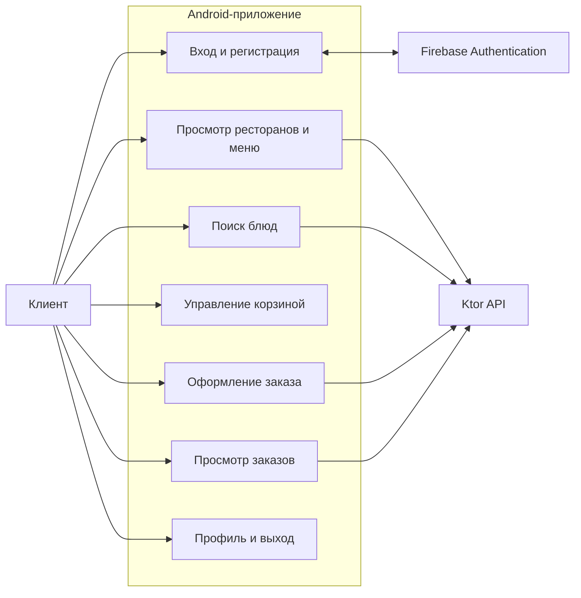
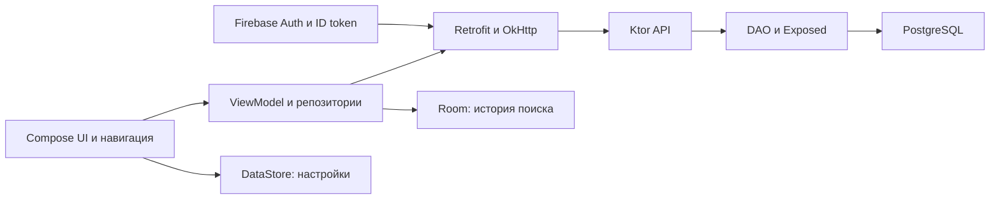
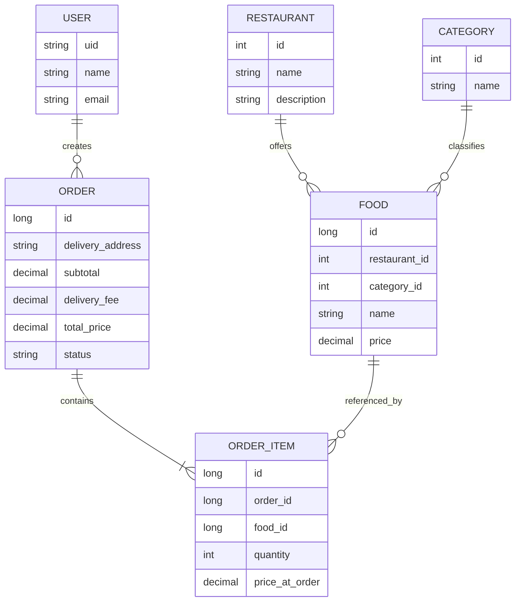
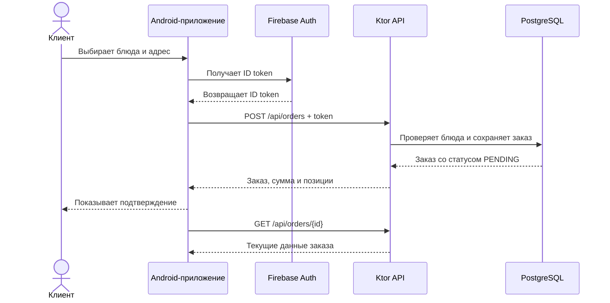

# Архитектура сервиса доставки еды

Актуальная модель составлена по исходному коду Android-клиента и Ktor-сервера в этом репозитории. Она описывает реализованный функционал, а не запланированные роли или операции.

Репозиторий: https://github.com/cheburec22283/my_project

## 1. Варианты использования

В клиенте реализованы вход и регистрация через Firebase Authentication, просмотр каталога и меню, поиск, корзина, оформление заказа, просмотр заказа/его статуса, профиль и выход. Отдельные акторы «Курьер» и «Администратор» не добавлены: сервер не содержит маршрутов изменения статуса доставки, администрирования каталога или получения статистики.

## 2. Контекст и компоненты

Клиентский интерфейс построен на Jetpack Compose. Навигация ведёт к экранам каталога, поиска, корзины, оформления заказа, отслеживания и профиля. Репозитории обращаются к Ktor через Retrofit и OkHttp. Firebase выдаёт токен; AuthInterceptor передаёт его защищённым запросам. Сервер использует Ktor, Exposed/HikariCP и PostgreSQL. Локальная Room-база хранит историю поиска; DataStore используется для пользовательских настроек темы. Содержимое корзины в Room не сохраняется.

## 3. Модель предметных данных

Серверные таблицы: `users`, `restaurants`, `categories`, `foods`, `orders`, `order_items`. Клиентские модели корзины (`Cart`, `CartItem`) существуют в приложении. Адрес доставки хранится строкой в заказе; самостоятельной таблицы адресов нет. Отдельной сущности отзывов в текущем коде нет.

На стороне приложения `Cart` содержит список `CartItem`; это состояние клиентского сценария, отдельной серверной таблицы корзины нет.

## 4. Реализованный обмен при заказе

Защищённый запрос создания заказа содержит адрес доставки и список пар «идентификатор блюда — количество». Сервер проверяет наличие адреса и позиций, создаёт заказ и возвращает его идентификатор, сумму, статус и позиции. Ставка доставки также доступна через отдельный маршрут расчёта. Текущая начальная стадия заказа — `PENDING`. Маршрута смены статуса в опубликованной реализации нет, поэтому смена статусов курьером не показана как реализованная.

## 5. Маршруты API, отражённые в диаграммах

| Метод | Маршрут | Назначение |
|---|---|---|
| GET | `/health` | Проверка состояния сервера |
| GET | `/api/categories` | Список категорий |
| GET | `/api/restaurants` | Список ресторанов |
| GET | `/api/restaurants/{id}` | Карточка ресторана |
| GET | `/api/restaurants/{id}/foods` | Меню ресторана |
| GET | `/api/foods` | Список блюд с параметрами страницы |
| GET | `/api/foods/search?q=...` | Поиск блюд |
| GET | `/api/foods/{id}` | Карточка блюда |
| GET | `/api/delivery-fee?subtotal=...` | Расчёт доставки |
| POST | `/api/auth/sync` | Синхронизация профиля после Firebase-аутентификации |
| POST | `/api/orders` | Создание заказа |
| GET | `/api/orders` | Заказы текущего пользователя |
| GET | `/api/orders/{id}` | Получение заказа |

Защищённые маршруты используют Firebase ID token. В модели, диаграммах и описании API не заявлены отдельные роли оператора/курьера, отзывы, таблица адресов, онлайн-оплата, панель статистики или серверная операция смены статуса заказа.
